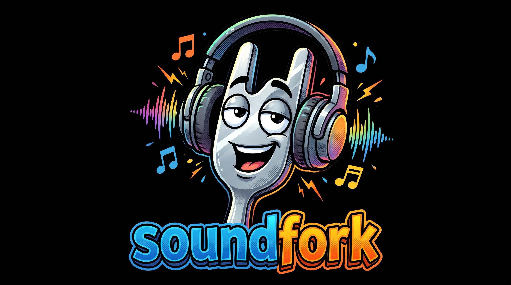

# SoundFork

<p align="center">
  
</p>

A VST3 effect for the end of a DAW's master bus (built with Ableton Live in mind).
It passes the master signal through completely unchanged, with zero added latency,
and mirrors a copy of it to a second, independently chosen Windows audio output
device (e.g. a Bluetooth headset), so you can monitor on your low-latency audio
interface and a second device at the same time without the second device's
buffering ever affecting the main signal path.

## Formats

| Format | Status |
|---|---|
| VST3 | Built for Ableton Live on Windows |
| Standalone | For testing the fork without a DAW |
| AAX | **Untested.** It compiles, but has never been loaded in Pro Tools |

The AAX build is also not signed. Retail Pro Tools only loads plugins signed with Avid's
PACE tools, so it needs a Pro Tools developer build to load at all.

Builds for each release are on the
[Releases](https://github.com/alienmind/soundfork/releases) page.

## How it works

- `processBlock` never modifies the buffer. The host's audio keeps flowing
  through at whatever latency the host/ASIO device is already running at.
- A copy of every block is pushed into a lock-free ring buffer
  (`Source/SecondaryOutputDevice.{h,cpp}`).
- A separate thread owns its own JUCE `AudioDeviceManager` output stream to
  the device you pick in the plugin UI, with its own configurable buffer size.
  It pulls from the ring buffer on its own schedule.
- If that secondary device stalls or falls behind, blocks are dropped (and
  counted) instead of ever blocking the host's real-time thread.

Code layout:

```
soundfork/
  CMakeLists.txt
  Source/
    PluginProcessor.h/.cpp     JUCE AudioProcessor: pass-through + state
    PluginEditor.h/.cpp        Device picker, buffer size, enable toggle
    SecondaryOutputDevice.h/.cpp  Ring buffer + second output device owner
```

## Known limitations

- No sample-rate conversion: if the secondary device's native rate differs
  from the DAW's session rate, audio will play back pitched/sped. The status
  line shows a warning when this happens.
- No hot-plug handling. The device list is only refreshed when the editor opens.
- Assumes stereo in/out on both the main bus and the secondary device.

## Toolchain setup (Windows host)

1. **Visual Studio 2026** (Community edition is fine)
   - Install the **"Desktop development with C++"** workload.
   - This gives you the MSVC compiler and the Visual Studio CMake generator.

2. **CMake** (>= 4.2, needed for the Visual Studio 2026 generator)
   - Visual Studio 2026 ships its own CMake, but installing it standalone
     from [cmake.org](https://cmake.org/download/) and adding it to `PATH`
     makes it easier to build from a plain terminal instead of only from
     inside Visual Studio.

3. **Git for Windows** - [git-scm.com](https://git-scm.com/download/win)
   - Needed because the build pulls JUCE itself via CMake `FetchContent`.
     JUCE bundles what it needs, so there is no separate SDK to download.

## Building

From any terminal with CMake on PATH:

```
git clone https://github.com/alienmind/soundfork
cd soundfork
cmake -B build -G "Visual Studio 18 2026" -A x64
cmake --build build --config Release
```

The first configure will take a few minutes, because it clones JUCE.

Because `COPY_PLUGIN_AFTER_BUILD` is enabled, a successful build copies the
VST3 straight into the system VST3 folder
(`C:\Program Files\Common Files\VST3\SoundFork.vst3`), so it should show up
next time Ableton Live rescans plugins.

A Standalone build is also produced at
`build\SoundFork_artefacts\Release\Standalone\SoundFork.exe`. Run that
first to exercise the device-fork logic without needing a DAW at all.

The AAX build stays in the build tree, at `build\aax-install\SoundFork.aaxplugin`.
It is not installed to the Avid folder.

## Releasing

Set the new version in `project(SoundFork VERSION ...)` in `CMakeLists.txt`, commit it, then
push a matching tag:

```
git tag v0.2.0
git push origin v0.2.0
```

GitHub Actions builds every format and publishes them as a GitHub Release. The build fails
if the tag and the version differ. A tag with a hyphen, such as `v0.2.0-beta.1`, publishes
as a prerelease.

## Testing checklist

1. Run the Standalone app, pick your Bluetooth device from the dropdown,
   confirm audio comes out of it with no main-thread impact.
2. Load the VST3 in Ableton Live on the master bus and repeat.
3. Confirm your ASIO interface (used for Ableton's main output) and the
   plugin's WASAPI secondary output can run simultaneously without the
   UMC driver complaining.

## Future: macOS

The code is written entirely against portable JUCE APIs (`AudioDeviceManager`,
`AudioIODeviceCallback`) with nothing Windows-specific, so an AU/VST3 build
for macOS should mostly be a matter of adding `AU` to `FORMATS` in
`CMakeLists.txt` and building on a Mac. Not attempted yet.
